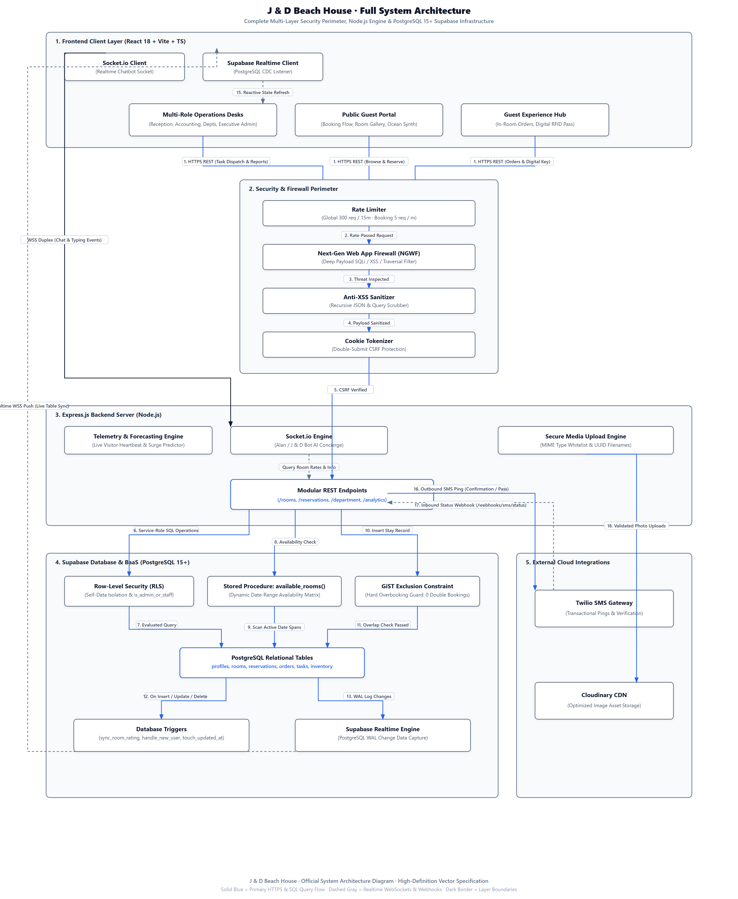
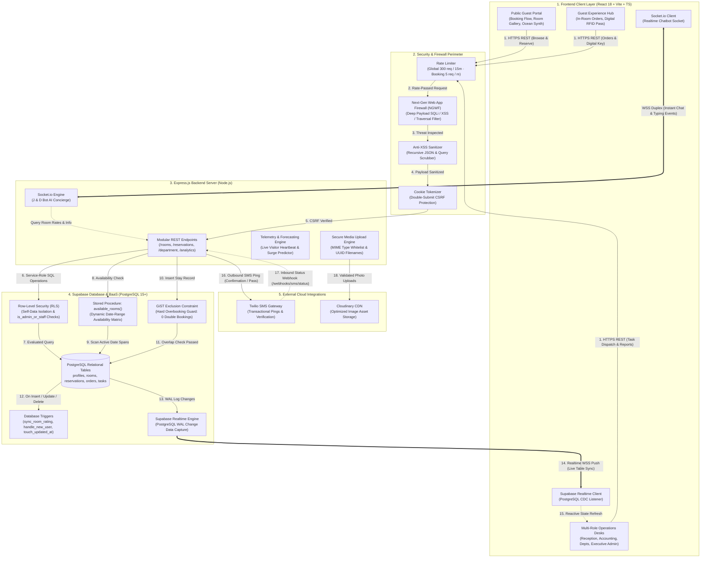

# System Architecture & Data Flow Diagram

**Platform**: J & D Beach House  
**Location**: Bolinao, Pangasinan  
**Architecture Pattern**: Decoupled Client-Server with Supabase BaaS (PostgreSQL + RLS + Realtime) & WebSocket Real-Time Chatbot  

---

## 1. High-Resolution Architecture Diagram



> [!TIP]
> **Available Architecture Diagrams & Viewers in this folder:**
> - 🌐 **Interactive System Architecture Viewer**: Open [`view_diagram.html`](./view_diagram.html) in your browser for infinite vector zoom.
> - 🌲 **Interactive Data Hierarchy Explorer**: Open [`data_hierarchy_viewer.html`](./data_hierarchy_viewer.html) in your browser for tabbed entity trees and RBAC levels.
> - 📐 **Vector SVG (System Architecture)**: [`system_architecture_diagram.svg`](./system_architecture_diagram.svg)
> - 📐 **Vector SVG (Data Hierarchy)**: [`data_hierarchy_diagram.svg`](./data_hierarchy_diagram.svg)
> - 🖼️ **High-Res Raster Image**: [`system_architecture_diagram.png`](./system_architecture_diagram.png) (1904 × 1516 pixels).
> - 📄 **Data Hierarchy Technical Document**: [**`docs/database/DATA_HIERARCHY.md`**](../database/DATA_HIERARCHY.md)

---

## 2. Interactive Flowchart (Mermaid)



---

## 3. Data Flow & Arrow Legend

| Arrow | Protocol | From ➔ To | Purpose & Data Payload |
| :--- | :--- | :--- | :--- |
| **🔵 Blue Solid Arrow (`-->`)** | `HTTPS (REST / JSON)` | **Client Layer ➔ Backend API Gateway** | Transmits room availability inquiries, reservation submissions, in-room service orders, department work orders, and analytics reporting. |
| **🟢 Cyan Duplex Arrow (`<=====>`)** | `WebSocket (WSS)` | **Client Browser ⟷ Socket.io Server** | High-speed, bidirectional communication powering instant guest concierge chat and typing indicators without HTTP polling overhead. |
| **🟣 Purple Solid Arrow (`====>`)** | `WebSocket (CDC)` | **Supabase Realtime ➔ Client Browser** | Listens to PostgreSQL Write-Ahead Log (WAL) event changes on `reservations`, `department_tasks`, and `resort_orders`, pushing instant updates to front desk and staff screens. |
| **🟩 Green Downward Arrow (`-->`)** | `PostgreSQL Wire / REST` | **Backend API ➔ Supabase Database** | Executes administrative database queries using the service role key, invokes the `available_rooms()` stored procedure, and triggers SQL transactions. |
| **🟠 Amber Arrow (`-.->`)** | `HTTPS / Webhooks` | **Backend API ⟷ Twilio SMS Gateway** | Outbound transactional SMS notifications sent upon booking confirmations or check-in, and inbound Twilio delivery receipt callbacks (`sent`, `delivered`, `failed`). |

---

## 4. Architectural Highlights & Invariants

1. **Hard Overbooking Prevention (GiST Constraint)**:
   - PostgreSQL prevents double-booking at the database level using a GiST index exclusion constraint:
     ```sql
     alter table reservations add constraint no_overbooking
       exclude using gist (
         room_id with =,
         daterange(check_in, check_out) with &&
       ) where (status in ('pending','confirmed','checked_in'));
     ```
2. **Next-Generation Web Application Firewall (NGWF)**:
   - Middleware regex inspection layer filtering malicious SQL injection patterns (`UNION SELECT`, `DROP TABLE`), path traversal attacks, command execution, and recursive XSS injections before requests reach route handlers.
3. **Double-Submit CSRF Protection & Tokenization**:
   - Cryptographically random session cookies coupled with header token verification for all state-mutating requests (`POST`, `PUT`, `PATCH`, `DELETE`).
4. **Offline Resilient Client Architecture**:
   - Integrated client-side mock accounts and fallback data structures ensure the frontend remains functional and responsive during staging, offline demos, or network dropouts.
