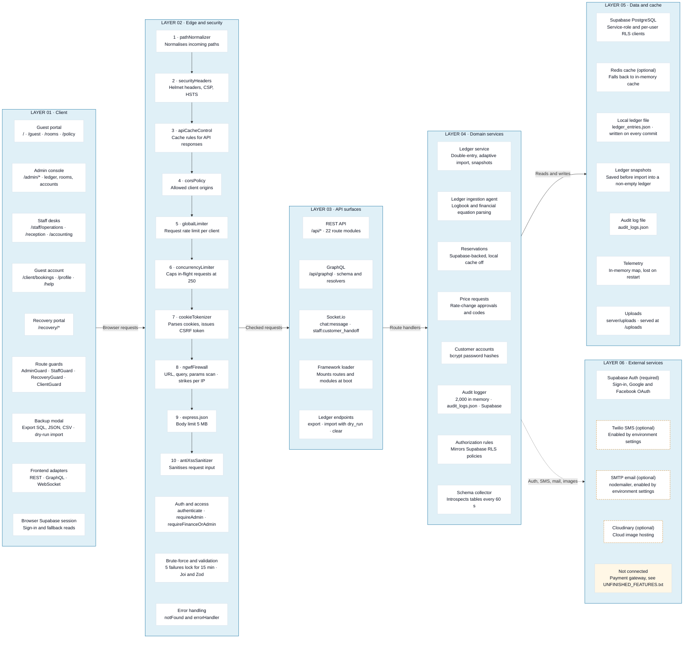

# Cross Architecture Map

patar-resort, `main` at commit `0550fc7`. The ledger import changes are uncommitted and included in layers 02 to 05. Dashed borders mark optional services.

## Request paths

1. **Ledger import (admin):** backup modal → `POST /api/ledger/backup/import` with `dry_run` → `requireAdmin` → parse and plan → snapshot → Supabase sync if configured → commit ledger file.
2. **Ledger export (admin):** backup modal → `GET /api/ledger/backup/export` → `requireAdmin` → `ledgerService` → SQL, JSON or CSV file.
3. **Live guest chat:** chat widget → Socket.io `chat:message` → `chatbot.js` → `staff:customer_handoff` → `staff_agents` room.
4. **Protected page load:** route guard → session token → edge middleware → `authenticate` → REST or GraphQL → Supabase or local data.

## Boot sequence

1. Load environment (`server/src/config/env.js`).
2. Register the security middleware chain (`server/src/index.js`).
3. Run `bootstrapFramework(app)`.
4. Create the HTTP or HTTPS server and attach the chat socket with `attachChatbot(server)`.
5. Listen on `PORT` (default 4000).
6. Start the schema collector with `startSchemaCollector(60000)`.
