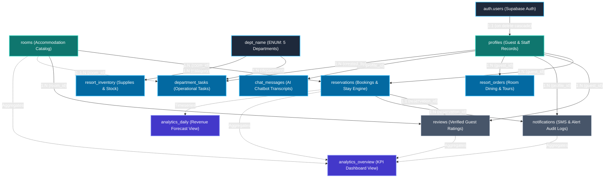

# J & D Beach House — System Data Hierarchy Specification

This document outlines the complete **Data Hierarchy** of the **J & D Beach House** management platform. It defines how data is structured, inherited, and isolated across organizational domains, relational entities, role-based access levels, and storage lifecycles.

---

## 1. High-Level Hierarchy Overview

The platform data hierarchy is structured across four orthogonal dimensions:
1. **Organizational Domain Hierarchy**: Functional business departments and operational areas.
2. **Relational Entity Hierarchy**: Parent-child database entity dependencies and cardinalities.
3. **Role-Based Access Control (RBAC) Hierarchy**: User authorization tiers and privilege inheritance.
4. **Data Storage & Lifecycle Hierarchy**: State mutability, caching, and backup retention tiers.

---

## 2. Organizational Domain Hierarchy

At the resort enterprise level, data is organized into six primary domains:

```
[Level 0: Resort Enterprise]
      └── J & D Beach House (Bolinao, Pangasinan)
            ├── 1. Identity & Profile Domain (IAM)
            │     ├── Authentication Credentials (Supabase Auth)
            │     └── Guest & Staff Profiles (Contact, Emergency, Role)
            │
            ├── 2. Accommodation & Asset Catalog Domain
            │     ├── Room Categories (Cottages, Suites, Villas, Dorms)
            │     ├── Accommodation Units & Capacity Thresholds
            │     └── Dynamic Amenity Specifications & Pricing Rates
            │
            ├── 3. Reservation & Stay Domain
            │     ├── Date-Range Booking Engine
            │     ├── GiST Mathematical Overbooking Constraint
            │     ├── Stay Lifecycle (Pending -> Confirmed -> Checked In -> Checked Out)
            │     └── Digital Pass & RFID Credentials
            │
            ├── 4. Service Fulfillment & Departmental Operations
            │     ├── Operational Tasks (Front Desk, Housekeeping, Kitchen, Tours, Maintenance)
            │     ├── Department Task Priorities & Status Workflows
            │     └── Resort Inventory & Reorder Point Tracking
            │
            ├── 5. Guest Engagement & Experience Domain
            │     ├── In-Room Dining & Tour Booking Orders
            │     ├── Verified Post-Stay Ratings & Reviews
            │     ├── SMS Outbound Notification Logs
            │     └── Realtime AI Receptionist Chat Transcripts
            │
            └── 6. Financial & Analytical Intelligence Domain
                  ├── Occupancy Projections & RevPAR Calculations
                  ├── Timeseries Revenue Aggregations
                  └── Department Task Completion & Labor Metrics
```

---

## 3. Relational Entity Dependency Hierarchy

In the relational database, entities exist in a strict dependency tree governed by foreign key constraints, cascade triggers, and mathematical exclusion rules:



### Entity Hierarchy Breakdown:

| Level | Table / Entity | Parent Entity | Cardinality | Deletion Behavior |
| :--- | :--- | :--- | :--- | :--- |
| **0** | `auth.users` | *None (Supabase Root)* | 1 | Master Auth Record |
| **0** | `rooms` | *None (Static Asset Root)* | 1 | Master Catalog Record |
| **0** | `dept_name` | *None (Enum Constant)* | 1 | Front Desk, Housekeeping, Kitchen, Tours, Maintenance |
| **1** | `profiles` | `auth.users` | 1 : 1 | `CASCADE` (Deleting auth user deletes profile) |
| **2** | `reservations` | `profiles` & `rooms` | N : 1 | `CASCADE` on profile; Restricted on room |
| **2** | `resort_orders` | `profiles` | N : 1 | `CASCADE` on profile |
| **2** | `chat_messages` | `profiles` | N : 1 | `CASCADE` on profile |
| **2** | `department_tasks` | `profiles` & `rooms` | N : 1 | `SET NULL` on profile & room |
| **2** | `resort_inventory` | `dept_name` | N : 1 | Master Stock Record |
| **3** | `reviews` | `reservations`, `rooms`, `profiles` | 1 : 1 (Res) | `CASCADE` (Only 1 review allowed per verified stay) |
| **3** | `notifications` | `reservations` & `profiles` | N : 1 | `CASCADE` on reservation & profile |
| **4** | `analytics_*` | `reservations`, `rooms`, `reviews` | N : 1 | Dynamic Materialized View Aggregations |

---

## 4. Role-Based Access Control (RBAC) Hierarchy

The security system enforces hierarchical authorization. Permissions flow downward; higher tiers inherit capabilities of lower tiers while maintaining strict isolation:

```
┌────────────────────────────────────────────────────────────────────────┐
│  LEVEL 4: ADMINISTRATOR (Executive Management)                         │
│  - Full system oversight and executive analytics dashboard              │
│  - Staff account provisioning and multi-role credential management     │
│  - Database backup execution and schema migration controls             │
│  - Global CSV export for compliance and auditing                       │
└──────────────────────────────────┬─────────────────────────────────────┘
                                   │
         ┌─────────────────────────┴─────────────────────────┐
         ▼                                                   ▼
┌───────────────────────────────────────┐   ┌────────────────────────────────────┐
│  LEVEL 3A: ACCOUNTING                 │   │  LEVEL 3B: RECEPTIONIST            │
│  - Revenue ledgers and cashflow audit │   │  - Front Desk check-in & check-out │
│  - Nightly rate adjustments           │   │  - Walk-in and online reservation  │
│  - Room billing reconciliation        │   │  - Room status assignment          │
│  - Weekly financial summaries         │   │  - Guest SMS alerts and pass dispatch│
└──────────────────┬────────────────────┘   └─────────────────┬──────────────────┘
                   │                                          │
                   └────────────────────┬─────────────────────┘
                                        ▼
┌────────────────────────────────────────────────────────────────────────┐
│  LEVEL 2: DEPARTMENT OPERATIONS STAFF                                  │
│  (Front Desk, Housekeeping, Kitchen, Tours, Maintenance)               │
│  - Department task queue (Pending -> In Progress -> Completed)         │
│  - Task priority dispatch (Urgent, High, Normal, Low)                  │
│  - Room status maintenance reporting (Clean, Dirty, Under Repair)     │
│  - Supply inventory consumption and stock level updates                │
└──────────────────────────────────┬─────────────────────────────────────┘
                                   │
                                   ▼
┌────────────────────────────────────────────────────────────────────────┐
│  LEVEL 1: CUSTOMER / GUEST (Public & Authenticated)                   │
│  - Browse active accommodation catalog and real-time room availability │
│  - Book reservation with guaranteed GiST overbooking protection        │
│  - Access personal Digital Stay Pass & Room Keycode                    │
│  - Order room dining, tour packages, and amenity upgrades              │
│  - Submit verified review and rating upon stay completion              │
│  - AI Receptionist 24/7 interactive chat assistance                    │
└────────────────────────────────────────────────────────────────────────┘
```

---

## 5. Data Storage & Lifecycle Hierarchy

Data is classified into 4 distinct physical and temporal tiers:

| Tier | Storage Medium | Mutability | Latency | Retention Policy | Examples |
| :--- | :--- | :--- | :--- | :--- | :--- |
| **Tier 1: Hot Realtime** | In-Memory (Node.js RAM), WebSockets, LocalStorage | Ephemeral / Realtime | < 15ms | Duration of session / connection | Socket.io chat rooms, typing indicators, `jd_session` JWT, CSRF tokens |
| **Tier 2: Operational OLTP** | PostgreSQL 15+ (Supabase BaaS) | Read/Write (Transactional) | < 50ms | Live active lifecycle | `reservations`, `profiles`, `department_tasks`, `resort_orders` |
| **Tier 3: Audit & Historical** | PostgreSQL Tables & Indexed Logs | Append-Only / Immutable | < 100ms | 7 Years (Compliance) | `notifications` (SMS provider logs), `reviews`, completed reservations |
| **Tier 4: Cold Disaster Recovery** | Local File System & Version Control (`backups/`) | Read-Only Snapshots | N/A (Offline) | Permanent Versioned History | `backups/database/*.sql`, system config JSONs, git release tags |

---

## 6. How to Query the Data Hierarchy

### 1. Retrieve a Guest's Complete Hierarchical Record:
```sql
select
  p.id as guest_id,
  p.full_name,
  p.phone,
  coalesce(json_agg(
    json_build_object(
      'reservation_id', r.id,
      'room', rm.name,
      'check_in', r.check_in,
      'check_out', r.check_out,
      'status', r.status,
      'orders', (
        select coalesce(json_agg(o.item_name), '[]'::json)
        from resort_orders o
        where o.guest_id = p.id
      ),
      'review', (
        select json_build_object('rating', v.rating, 'comment', v.comment)
        from reviews v
        where v.reservation_id = r.id
      )
    )
  ) filter (where r.id is not null), '[]'::json) as stay_history
from profiles p
left join reservations r on r.guest_id = p.id
left join rooms rm on rm.id = r.room_id
where p.id = :target_guest_id
group by p.id;
```

### 2. Retrieve Department Operational Hierarchy:
```sql
select
  d.department,
  count(d.id) as total_tasks,
  count(d.id) filter (where d.status = 'completed') as completed_tasks,
  count(d.id) filter (where d.priority = 'urgent') as urgent_tasks,
  (
    select coalesce(json_agg(json_build_object('item', i.item_name, 'stock', i.stock_qty)), '[]'::json)
    from resort_inventory i
    where i.category = d.department
  ) as supplies
from department_tasks d
group by d.department;
```
