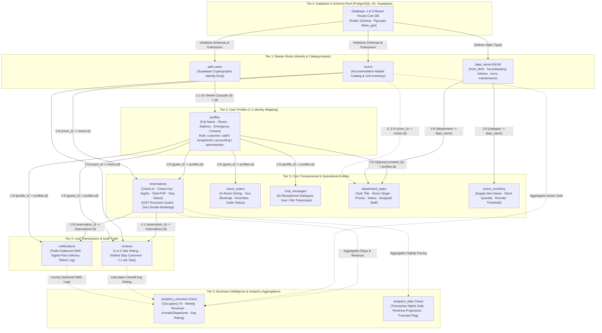
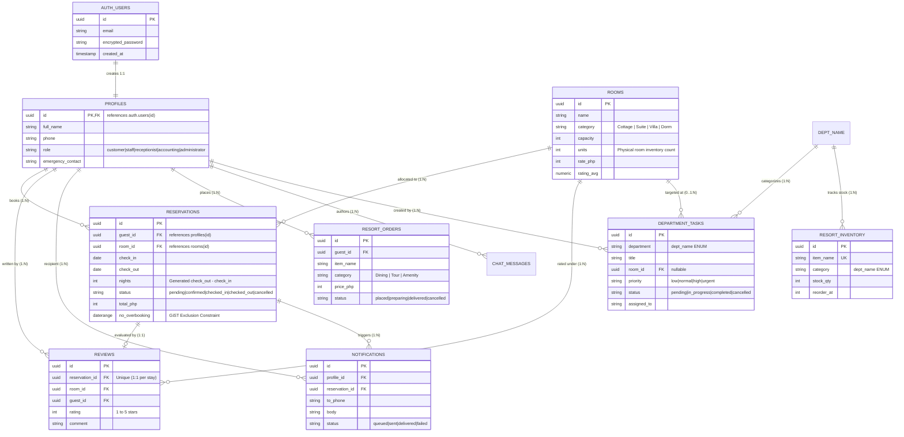

# J & D Beach House — Data Hierarchy Diagram

This document contains the native **Mermaid Data Hierarchy Diagram** for the J & D Beach House management system. It renders directly in markdown viewers without requiring raster or static image files.

---

## 1. System Data Hierarchy Diagram (Flowchart TD)

---

## 2. Entity-Relationship Data Hierarchy (ER Diagram)

