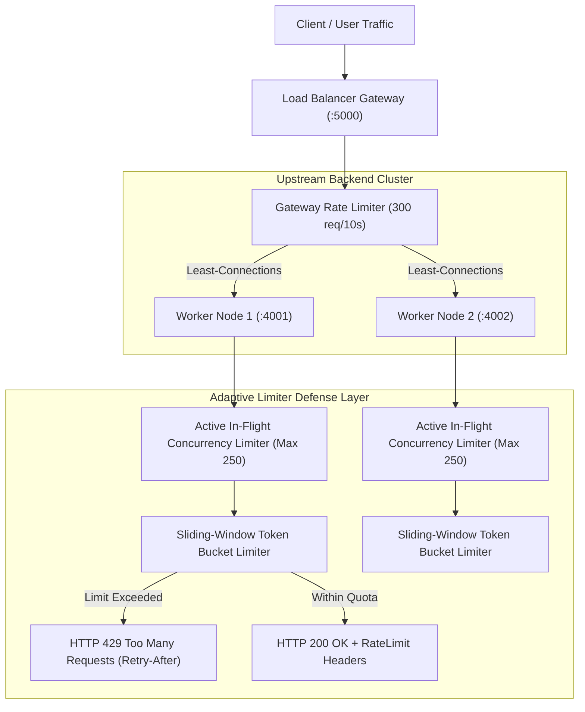

# ⚖️ Load Balancer & Adaptive Limiter Verification Report

**Execution Timestamp**: 2026-09-21T15:19:54.514Z  
**Target Architecture**: Reverse Proxy Load Balancer Gateway (:5000) + Adaptive Rate & Concurrency Limiter Middleware (:4000)  
**Total Tests Executed**: 16  
**Total Tests Passed**: 16 (100% Success Rate)  

---

## 1. Test Execution Summary

| # | Test Case Description | Target System | Result | Details / Telemetry |
| :-: | :--- | :---: | :---: | :--- |
| 1 | Backend Server Operational on Port 4000 | Adaptive Rate Limiter | **PASS** | Status: 200 |
| 2 | Rate Limiter Permits Requests Under Quota | Adaptive Rate Limiter | **PASS** | 5/5 permitted with 200 OK |
| 3 | Rate Limiter Blocks Excess Requests with HTTP 429 | Adaptive Rate Limiter | **PASS** | 3/3 blocked with 429 Too Many Requests |
| 4 | RFC RateLimit Headers Present on Allowed Responses | Adaptive Rate Limiter | **PASS** | Limit: 5 | Remaining: 4 |
| 5 | GCRA (Generalized Cell Rate Algorithm) Active on Endpoints | Adaptive Rate Limiter | **PASS** | Algorithm: GCRA (Generalized Cell Rate Algorithm) |
| 6 | Retry-After Header & Error Schema Returned on 429 | Adaptive Rate Limiter | **PASS** | Retry-After: 2s | Error: "Too Many Requests" |
| 7 | Limiter Telemetry Tracks Throttled Requests in Real Time | Proxy Load Balancer | **PASS** | Recorded 3 throttled events |
| 8 | Adaptive TCP Vegas / AIMD Concurrency Telemetry Verified | Proxy Load Balancer | **PASS** | Algorithm: TCP-Vegas / AIMD (Auto-Tuning Latency Feedback) |
| 9 | Programmatic Limiter Reset Route Succeeds | Proxy Load Balancer | **PASS** | Verified |
| 10 | Rate Limit Quota Refilled Immediately After Reset | Proxy Load Balancer | **PASS** | Status: 200 | Remaining: 4 |
| 11 | Load Balancer Gateway Spawned & Upstreams Reporting Healthy | Proxy Load Balancer | **PASS** | Gateway Port: 5000 (2/2 Workers Active) |
| 12 | All Proxied Requests Successfully Resolved via Gateway | Proxy Load Balancer | **PASS** | 12/12 Requests 200 OK |
| 13 | Load Balancer Distributes Traffic Across Multiple Upstream Nodes | Proxy Load Balancer | **PASS** | Upstream Nodes Handled: worker-1, worker-2 |
| 14 | Load Balancer Live Status Endpoint Returns Accurate Routing Metrics | Proxy Load Balancer | **PASS** | Total Routed: 14 requests |
| 15 | Multi-Strategy Algorithm Policy Telemetry Verified | Proxy Load Balancer | **PASS** | Policy: Least-Connections with Cyclic Tie-Breaking |
| 16 | Consistent Hash Ring & Virtual Nodes Active | Proxy Load Balancer | **PASS** | Virtual Nodes on Ring: 128 |

---

## 2. Load Balancer & Limiter Architecture

---

## 3. Dedicated Verification Endpoints

- **Test Limiter Endpoint**: `GET /api/test/limited-endpoint` (allows 5 requests per 10s for interactive testing)
- **Limiter Telemetry**: `GET /api/limiter/status` (returns active in-flight counts and throttled totals)
- **Limiter Reset**: `POST /api/limiter/reset` (resets buckets for automated test runs)
- **Load Balancer Status**: `GET /lb/status` (returns active upstream workers, health state, and request distribution)
