# Public pages: labeled screenshots and UI inventory

Captured from https://patar-resort.pages.dev on 2026-11-28 with headless Edge. Every button, link, field, dropdown, checkbox, form and open modal is outlined and numbered on its screenshot; the table under each page says what each number is.

Colors: button = blue, link = green, field = amber, dropdown = dark amber, checkbox = purple, tab = teal, form = grey dashed, modal = red dashed.

Re-run after a deploy: `node capture.mjs <site> docs/ui-inventory/screenshots`, then `node make_report.mjs docs/ui-inventory` (both scripts are in docs/ui-inventory/tools).

## Summary

| # | Page | View | Address | Buttons | Links | Fields | Dropdowns | Checkboxes | Forms | Controls without a label |
|---|---|---|---|---|---|---|---|---|---|---|
| 1 | [01-home](#01-home) | desktop 1440x900 | `/` | 8 | 13 | 0 | 0 | 0 | 0 | 0 |
| 2 | [02-home-chat-open](#02-home-chat-open) | desktop 1440x900 | `/` | 13 | 13 | 1 | 0 | 0 | 1 | 0 |
| 3 | [03-rooms](#03-rooms) | desktop 1440x900 | `/rooms` | 9 | 19 | 1 | 0 | 0 | 0 | 0 |
| 4 | [04-policy](#04-policy) | desktop 1440x900 | `/policy` | 11 | 9 | 1 | 1 | 0 | 1 | 0 |
| 5 | [05-terms](#05-terms) | desktop 1440x900 | `/terms` | 11 | 9 | 1 | 1 | 0 | 1 | 0 |
| 6 | [06-rules](#06-rules) | desktop 1440x900 | `/rules` | 11 | 9 | 1 | 1 | 0 | 1 | 0 |
| 7 | [07-privacy](#07-privacy) | desktop 1440x900 | `/privacy` | 11 | 9 | 1 | 1 | 0 | 1 | 0 |
| 8 | [08-data-deletion](#08-data-deletion) | desktop 1440x900 | `/data-deletion` | 11 | 9 | 1 | 1 | 0 | 1 | 0 |
| 9 | [09-guest-login](#09-guest-login) | desktop 1440x900 | `/client/login` | 8 | 1 | 2 | 0 | 0 | 1 | 0 |
| 10 | [10-guest-create-account](#10-guest-create-account) | desktop 1440x900 | `/client/login` | 7 | 1 | 5 | 0 | 1 | 1 | 0 |
| 11 | [11-guest-forgot-password](#11-guest-forgot-password) | desktop 1440x900 | `/client/login` | 3 | 1 | 1 | 0 | 0 | 1 | 0 |
| 12 | [12-staff-login](#12-staff-login) | desktop 1440x900 | `/staff/login` | 2 | 1 | 2 | 0 | 0 | 1 | 0 |
| 13 | [13-staff-forgot-password](#13-staff-forgot-password) | desktop 1440x900 | `/staff/login` | 2 | 1 | 2 | 0 | 0 | 1 | 0 |
| 14 | [14-admin-login](#14-admin-login) | desktop 1440x900 | `/admin` | 2 | 2 | 2 | 0 | 0 | 1 | 0 |
| 15 | [15-recovery](#15-recovery) | desktop 1440x900 | `/recovery` | 3 | 5 | 0 | 0 | 0 | 0 | 0 |
| 16 | [16-mobile-home](#16-mobile-home) | mobile 390x844 | `/` | 8 | 13 | 0 | 0 | 0 | 0 | 0 |
| 17 | [17-mobile-home-chat-open](#17-mobile-home-chat-open) | mobile 390x844 | `/` | 13 | 13 | 1 | 0 | 0 | 1 | 0 |
| 18 | [18-mobile-guest-login](#18-mobile-guest-login) | mobile 390x844 | `/client/login` | 8 | 1 | 2 | 0 | 0 | 1 | 0 |
| 19 | [19-mobile-guest-create-account](#19-mobile-guest-create-account) | mobile 390x844 | `/client/login` | 7 | 1 | 5 | 0 | 1 | 1 | 0 |
| 20 | [20-mobile-policy](#20-mobile-policy) | mobile 390x844 | `/policy` | 11 | 9 | 1 | 1 | 0 | 1 | 0 |

## Findings

1. **No unlabeled controls on the public pages.** Every button, link and field has a readable name.
2. **Admin sign-in fields are named only by their placeholder.** The captions "Administrator username or email" and "Password" are not linked to the inputs, so screen readers read "e.g. jjd001.administrator@rockview.ph". That placeholder also shows the format of admin login IDs.
3. **The recovery console shows to signed-out visitors.** `/recovery` renders the console with "Database Notice: Missing token", mentions Supabase on screen, and says "Queue is Clear" even though nothing loaded. No data is exposed (the server refuses the request), but the page should show only a sign-in prompt.
4. **Staff sign-in has no "Forgot password" link.** The admin and guest sign-in pages both have one.
5. **The chat box input is named only by its placeholder** ("Ask about rooms, rates, amenities, check-in…").
6. **Signed-in pages are not in this capture.** The guest dashboard (`/client`, bookings, book, help, profile, requests), the staff portal (`/staff/operations`, `/staff/reception`, `/staff/accounting`), the admin console and the signed-in recovery console need an account. Signed out, `/client/book` and `/client/help` show the sign-in page.

## 01-home

**Address:** `/` · **View:** desktop 1440x900 · **Page height:** 5389px

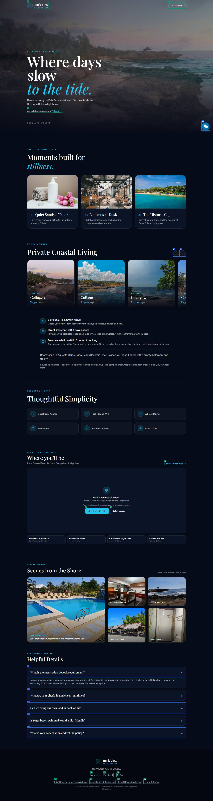

| # | Type | Label | Goes to / state |
|---|---|---|---|
| 1 | link | Rock View Beach Resort | `/`, stays on screen when scrolling |
| 2 | link | SIGN IN | `/client/login`, stays on screen when scrolling |
| 3 | link | Already have an account? Sign in → | `/client/login` |
| 4 | button | Scroll accommodations left |  |
| 5 | button | Scroll accommodations right |  |
| 6 | link | Open in Google Maps ↗ | `https://www.google.com/maps/search/?api=1&query=Rock+View+Beach+Resort,+Patar+Road,+Bolinao,+Pangasinan` |
| 7 | link | Open in Google Maps | `https://www.google.com/maps/search/?api=1&query=Rock+View+Beach+Resort,+Patar+Road,+Bolinao,+Pangasinan` |
| 8 | link | Get directions | `https://www.google.com/maps/dir/?api=1&destination=Rock+View+Beach+Resort,+Patar+Road,+Bolinao,+Pangasinan` |
| 9 | button | What is the reservation deposit requirement? + |  |
| 10 | button | What are your check-in and check-out times? + |  |
| 11 | button | Can we bring our own food or cook on site? + |  |
| 12 | button | Is Patar beach swimmable and child-friendly? + |  |
| 13 | button | What is your cancellation and refund policy? + |  |
| 14 | link | Instagram | `https://www.instagram.com/rockviewbeachresort` |
| 15 | link | Facebook | `https://www.facebook.com/rockviewbeachresort` |
| 16 | link | TikTok | `https://www.tiktok.com/@rockviewbeachresort` |
| 17 | link | 50% Downpayment Policy & Rules | `/policy` |
| 18 | link | Cancellation & Rebooking | `/policy#cancellation` |
| 19 | link | Resort House Guidelines | `/policy#house-rules` |
| 20 | link | Privacy & Terms | `/policy#privacy` |
| 21 | button | Open 24/7 Resort Concierge Chat | stays on screen when scrolling |

## 02-home-chat-open

**Address:** `/` · **View:** desktop 1440x900 · **Page height:** 5389px

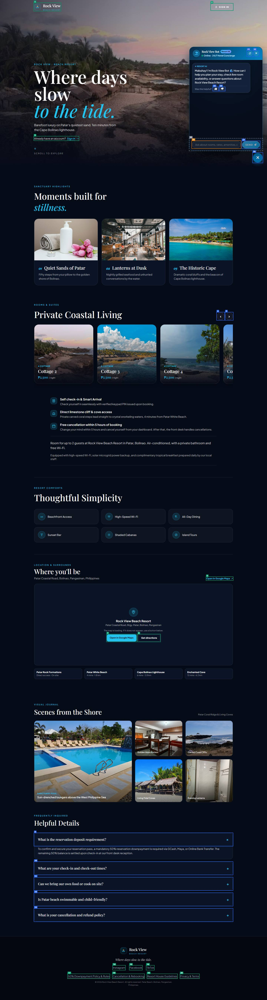

| # | Type | Label | Goes to / state |
|---|---|---|---|
| 1 | link | Rock View Beach Resort | `/`, stays on screen when scrolling |
| 2 | link | SIGN IN | `/client/login`, stays on screen when scrolling |
| 3 | link | Already have an account? Sign in → | `/client/login` |
| 4 | button | Scroll accommodations left |  |
| 5 | button | Scroll accommodations right |  |
| 6 | link | Open in Google Maps ↗ | `https://www.google.com/maps/search/?api=1&query=Rock+View+Beach+Resort,+Patar+Road,+Bolinao,+Pangasinan` |
| 7 | link | Open in Google Maps | `https://www.google.com/maps/search/?api=1&query=Rock+View+Beach+Resort,+Patar+Road,+Bolinao,+Pangasinan` |
| 8 | link | Get directions | `https://www.google.com/maps/dir/?api=1&destination=Rock+View+Beach+Resort,+Patar+Road,+Bolinao,+Pangasinan` |
| 9 | button | What is the reservation deposit requirement? + |  |
| 10 | button | What are your check-in and check-out times? + |  |
| 11 | button | Can we bring our own food or cook on site? + |  |
| 12 | button | Is Patar beach swimmable and child-friendly? + |  |
| 13 | button | What is your cancellation and refund policy? + |  |
| 14 | link | Instagram | `https://www.instagram.com/rockviewbeachresort` |
| 15 | link | Facebook | `https://www.facebook.com/rockviewbeachresort` |
| 16 | link | TikTok | `https://www.tiktok.com/@rockviewbeachresort` |
| 17 | link | 50% Downpayment Policy & Rules | `/policy` |
| 18 | link | Cancellation & Rebooking | `/policy#cancellation` |
| 19 | link | Resort House Guidelines | `/policy#house-rules` |
| 20 | link | Privacy & Terms | `/policy#privacy` |
| 21 | button | Restart chat | stays on screen when scrolling |
| 22 | button | Close chat | stays on screen when scrolling |
| 23 | button | Thumbs up - Helpful | stays on screen when scrolling |
| 24 | button | Thumbs down - Needs improvement | stays on screen when scrolling |
| 25 | form | _(none)_ | stays on screen when scrolling |
| 26 | field | Ask about rooms, rates, amenities, check-in… | stays on screen when scrolling |
| 27 | button | SEND | disabled, stays on screen when scrolling |
| 28 | button | Open 24/7 Resort Concierge Chat | stays on screen when scrolling |

## 03-rooms

**Address:** `/rooms` · **View:** desktop 1440x900 · **Page height:** 3898px

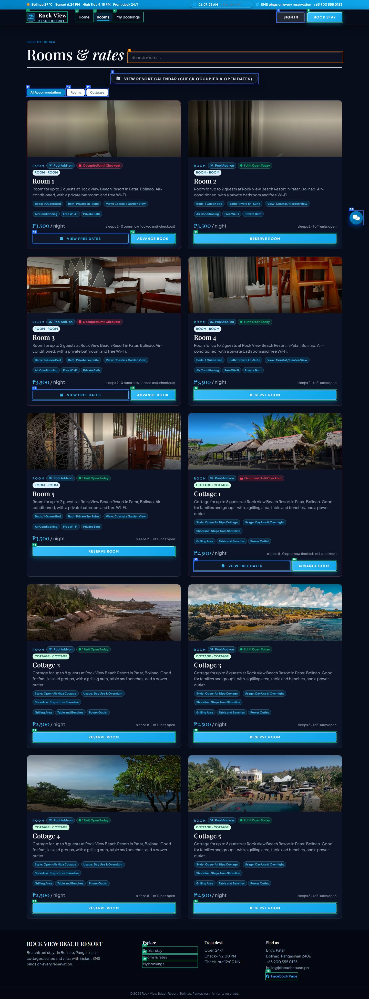

| # | Type | Label | Goes to / state |
|---|---|---|---|
| 1 | link | Rock View BEACH RESORT | `/`, stays on screen when scrolling |
| 2 | link | Home | `/`, stays on screen when scrolling |
| 3 | link | Rooms | `/rooms`, stays on screen when scrolling |
| 4 | link | My Bookings | `/client/bookings`, stays on screen when scrolling |
| 5 | button | SIGN IN | stays on screen when scrolling |
| 6 | link | BOOK STAY | `/`, stays on screen when scrolling |
| 7 | field | Search rooms… |  |
| 8 | button | VIEW RESORT CALENDAR (CHECK OCCUPIED & OPEN DATES) |  |
| 9 | button | All Accommodations |  |
| 10 | button | Rooms |  |
| 11 | button | Cottages |  |
| 12 | button | VIEW FREE DATES |  |
| 13 | link | ADVANCE BOOK | `/` |
| 14 | link | RESERVE ROOM | `/` |
| 15 | button | VIEW FREE DATES |  |
| 16 | link | ADVANCE BOOK | `/` |
| 17 | link | RESERVE ROOM | `/` |
| 18 | link | RESERVE ROOM | `/` |
| 19 | button | VIEW FREE DATES |  |
| 20 | link | ADVANCE BOOK | `/` |
| 21 | link | RESERVE ROOM | `/` |
| 22 | link | RESERVE ROOM | `/` |
| 23 | link | RESERVE ROOM | `/` |
| 24 | link | RESERVE ROOM | `/` |
| 25 | link | Book a stay | `/` |
| 26 | link | Rooms & rates | `/rooms` |
| 27 | link | My bookings | `/my-bookings` |
| 28 | link | Facebook Page | `https://www.facebook.com/rockviewbeachresort` |
| 29 | button | Open 24/7 Resort Concierge Chat | stays on screen when scrolling |

## 04-policy

**Address:** `/policy` · **View:** desktop 1440x900 · **Page height:** 4443px

| # | Type | Label | Goes to / state |
|---|---|---|---|
| 1 | link | Back to Resort | `/`, stays on screen when scrolling |
| 2 | link | Book a Stay | `/#booking`, stays on screen when scrolling |
| 3 | button | 50% Downpayment |  |
| 4 | button | Check-in / Check-out |  |
| 5 | button | Cancellation & Weather |  |
| 6 | button | House Rules & Quiet Hours |  |
| 7 | button | Pool & Beachfront |  |
| 8 | button | Dining & Zero Corkage |  |
| 9 | button | Pet Policy |  |
| 10 | button | Power, Wi-Fi & Safety |  |
| 11 | button | User Data Deletion |  |
| 12 | link | Resident Guest Portal | `/client/login` |
| 13 | form | _(none)_ |  |
| 14 | field | Enter your Facebook / Google account email address... |  |
| 15 | dropdown | Deletion scope |  |
| 16 | button | Request Data Deletion |  |
| 17 | link | Reserve Your Stay Now | `/#booking` |
| 18 | link | Home | `/` |
| 19 | link | Rooms & Cottages | `/rooms` |
| 20 | link | Guest Dashboard | `/client/bookings` |
| 21 | link | Policies & 50% Deposit | `/policy` |
| 22 | link | User Data Deletion | `/data-deletion` |
| 23 | button | Open 24/7 Resort Concierge Chat | stays on screen when scrolling |

## 05-terms

**Address:** `/terms` · **View:** desktop 1440x900 · **Page height:** 4443px

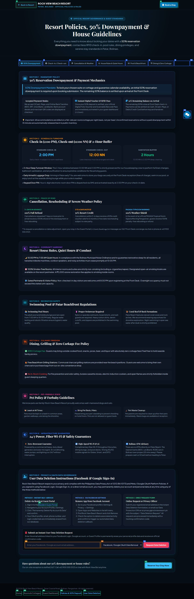

| # | Type | Label | Goes to / state |
|---|---|---|---|
| 1 | link | Back to Resort | `/`, stays on screen when scrolling |
| 2 | link | Book a Stay | `/#booking`, stays on screen when scrolling |
| 3 | button | 50% Downpayment |  |
| 4 | button | Check-in / Check-out |  |
| 5 | button | Cancellation & Weather |  |
| 6 | button | House Rules & Quiet Hours |  |
| 7 | button | Pool & Beachfront |  |
| 8 | button | Dining & Zero Corkage |  |
| 9 | button | Pet Policy |  |
| 10 | button | Power, Wi-Fi & Safety |  |
| 11 | button | User Data Deletion |  |
| 12 | link | Resident Guest Portal | `/client/login` |
| 13 | form | _(none)_ |  |
| 14 | field | Enter your Facebook / Google account email address... |  |
| 15 | dropdown | Deletion scope |  |
| 16 | button | Request Data Deletion |  |
| 17 | link | Reserve Your Stay Now | `/#booking` |
| 18 | link | Home | `/` |
| 19 | link | Rooms & Cottages | `/rooms` |
| 20 | link | Guest Dashboard | `/client/bookings` |
| 21 | link | Policies & 50% Deposit | `/policy` |
| 22 | link | User Data Deletion | `/data-deletion` |
| 23 | button | Open 24/7 Resort Concierge Chat | stays on screen when scrolling |

## 06-rules

**Address:** `/rules` · **View:** desktop 1440x900 · **Page height:** 4443px

| # | Type | Label | Goes to / state |
|---|---|---|---|
| 1 | link | Back to Resort | `/`, stays on screen when scrolling |
| 2 | link | Book a Stay | `/#booking`, stays on screen when scrolling |
| 3 | button | 50% Downpayment |  |
| 4 | button | Check-in / Check-out |  |
| 5 | button | Cancellation & Weather |  |
| 6 | button | House Rules & Quiet Hours |  |
| 7 | button | Pool & Beachfront |  |
| 8 | button | Dining & Zero Corkage |  |
| 9 | button | Pet Policy |  |
| 10 | button | Power, Wi-Fi & Safety |  |
| 11 | button | User Data Deletion |  |
| 12 | link | Resident Guest Portal | `/client/login` |
| 13 | form | _(none)_ |  |
| 14 | field | Enter your Facebook / Google account email address... |  |
| 15 | dropdown | Deletion scope |  |
| 16 | button | Request Data Deletion |  |
| 17 | link | Reserve Your Stay Now | `/#booking` |
| 18 | link | Home | `/` |
| 19 | link | Rooms & Cottages | `/rooms` |
| 20 | link | Guest Dashboard | `/client/bookings` |
| 21 | link | Policies & 50% Deposit | `/policy` |
| 22 | link | User Data Deletion | `/data-deletion` |
| 23 | button | Open 24/7 Resort Concierge Chat | stays on screen when scrolling |

## 07-privacy

**Address:** `/privacy` · **View:** desktop 1440x900 · **Page height:** 4443px

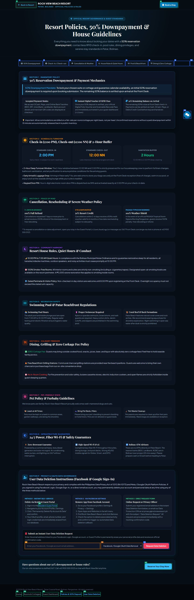

| # | Type | Label | Goes to / state |
|---|---|---|---|
| 1 | link | Back to Resort | `/`, stays on screen when scrolling |
| 2 | link | Book a Stay | `/#booking`, stays on screen when scrolling |
| 3 | button | 50% Downpayment |  |
| 4 | button | Check-in / Check-out |  |
| 5 | button | Cancellation & Weather |  |
| 6 | button | House Rules & Quiet Hours |  |
| 7 | button | Pool & Beachfront |  |
| 8 | button | Dining & Zero Corkage |  |
| 9 | button | Pet Policy |  |
| 10 | button | Power, Wi-Fi & Safety |  |
| 11 | button | User Data Deletion |  |
| 12 | link | Resident Guest Portal | `/client/login` |
| 13 | form | _(none)_ |  |
| 14 | field | Enter your Facebook / Google account email address... |  |
| 15 | dropdown | Deletion scope |  |
| 16 | button | Request Data Deletion |  |
| 17 | link | Reserve Your Stay Now | `/#booking` |
| 18 | link | Home | `/` |
| 19 | link | Rooms & Cottages | `/rooms` |
| 20 | link | Guest Dashboard | `/client/bookings` |
| 21 | link | Policies & 50% Deposit | `/policy` |
| 22 | link | User Data Deletion | `/data-deletion` |
| 23 | button | Open 24/7 Resort Concierge Chat | stays on screen when scrolling |

## 08-data-deletion

**Address:** `/data-deletion` · **View:** desktop 1440x900 · **Page height:** 4443px

| # | Type | Label | Goes to / state |
|---|---|---|---|
| 1 | link | Back to Resort | `/`, stays on screen when scrolling |
| 2 | link | Book a Stay | `/#booking`, stays on screen when scrolling |
| 3 | button | 50% Downpayment |  |
| 4 | button | Check-in / Check-out |  |
| 5 | button | Cancellation & Weather |  |
| 6 | button | House Rules & Quiet Hours |  |
| 7 | button | Pool & Beachfront |  |
| 8 | button | Dining & Zero Corkage |  |
| 9 | button | Pet Policy |  |
| 10 | button | Power, Wi-Fi & Safety |  |
| 11 | button | User Data Deletion |  |
| 12 | link | Resident Guest Portal | `/client/login` |
| 13 | form | _(none)_ |  |
| 14 | field | Enter your Facebook / Google account email address... |  |
| 15 | dropdown | Deletion scope |  |
| 16 | button | Request Data Deletion |  |
| 17 | link | Reserve Your Stay Now | `/#booking` |
| 18 | link | Home | `/` |
| 19 | link | Rooms & Cottages | `/rooms` |
| 20 | link | Guest Dashboard | `/client/bookings` |
| 21 | link | Policies & 50% Deposit | `/policy` |
| 22 | link | User Data Deletion | `/data-deletion` |
| 23 | button | Open 24/7 Resort Concierge Chat | stays on screen when scrolling |

## 09-guest-login

**Address:** `/client/login` · **View:** desktop 1440x900 · **Page height:** 900px

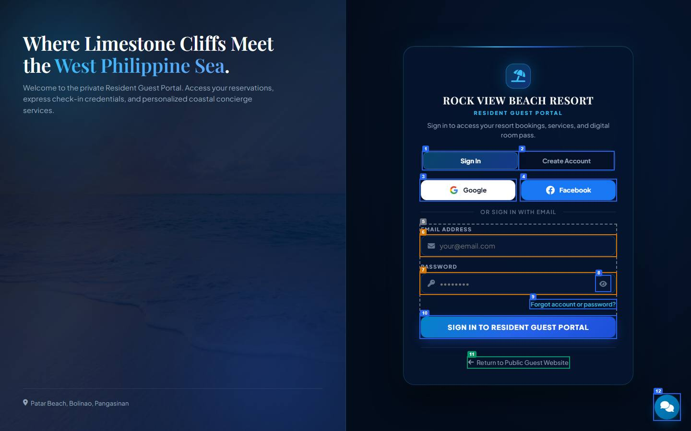

| # | Type | Label | Goes to / state |
|---|---|---|---|
| 1 | button | Sign In |  |
| 2 | button | Create Account |  |
| 3 | button | Google |  |
| 4 | button | Facebook |  |
| 5 | form | _(none)_ |  |
| 6 | field | EMAIL ADDRESS |  |
| 7 | field | PASSWORD |  |
| 8 | button | Show password |  |
| 9 | button | Forgot account or password? |  |
| 10 | button | SIGN IN TO RESIDENT GUEST PORTAL |  |
| 11 | link | Return to Public Guest Website | `/` |
| 12 | button | Open 24/7 Resort Concierge Chat | stays on screen when scrolling |

## 10-guest-create-account

**Address:** `/client/login` · **View:** desktop 1440x900 · **Page height:** 980px

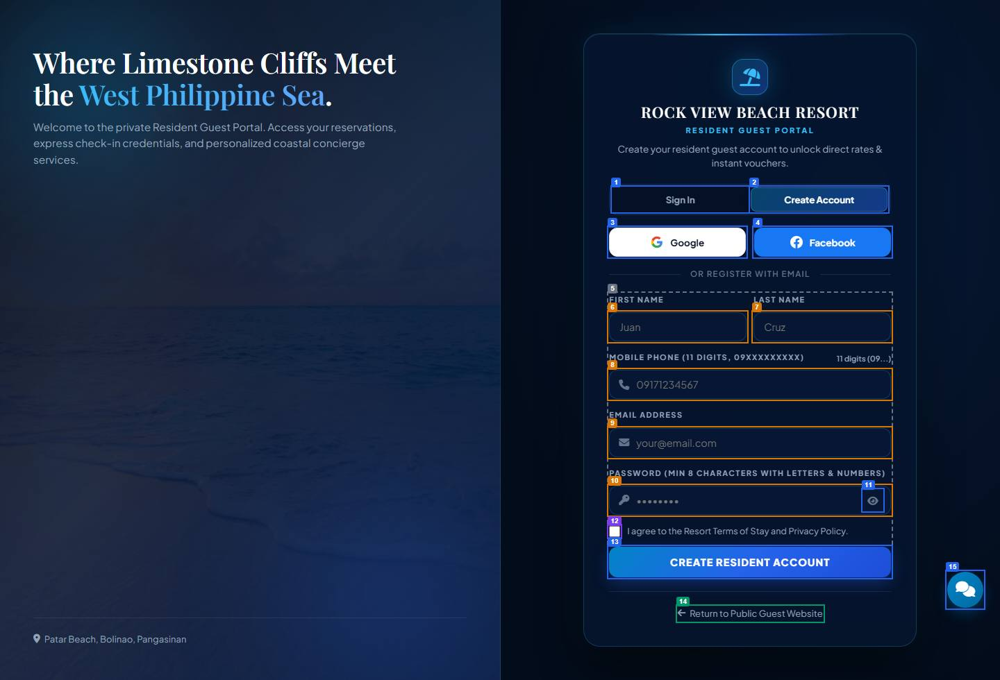

| # | Type | Label | Goes to / state |
|---|---|---|---|
| 1 | button | Sign In |  |
| 2 | button | Create Account |  |
| 3 | button | Google |  |
| 4 | button | Facebook |  |
| 5 | form | _(none)_ |  |
| 6 | field | FIRST NAME |  |
| 7 | field | LAST NAME |  |
| 8 | field | MOBILE PHONE (11 DIGITS, 09XXXXXXXXX) |  |
| 9 | field | EMAIL ADDRESS |  |
| 10 | field | PASSWORD (MIN 8 CHARACTERS WITH LETTERS & NUMBERS) |  |
| 11 | button | Show password |  |
| 12 | checkbox | I agree to the Resort Terms of Stay and Privacy Policy. |  |
| 13 | button | CREATE RESIDENT ACCOUNT |  |
| 14 | link | Return to Public Guest Website | `/` |
| 15 | button | Open 24/7 Resort Concierge Chat | stays on screen when scrolling |

## 11-guest-forgot-password

**Address:** `/client/login` · **View:** desktop 1440x900 · **Page height:** 900px

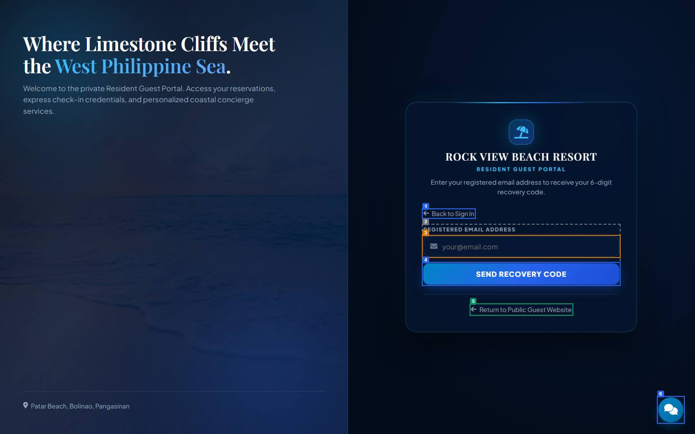

| # | Type | Label | Goes to / state |
|---|---|---|---|
| 1 | button | Back to Sign In |  |
| 2 | form | _(none)_ |  |
| 3 | field | REGISTERED EMAIL ADDRESS |  |
| 4 | button | SEND RECOVERY CODE |  |
| 5 | link | Return to Public Guest Website | `/` |
| 6 | button | Open 24/7 Resort Concierge Chat | stays on screen when scrolling |

## 12-staff-login

**Address:** `/staff/login` · **View:** desktop 1440x900 · **Page height:** 900px

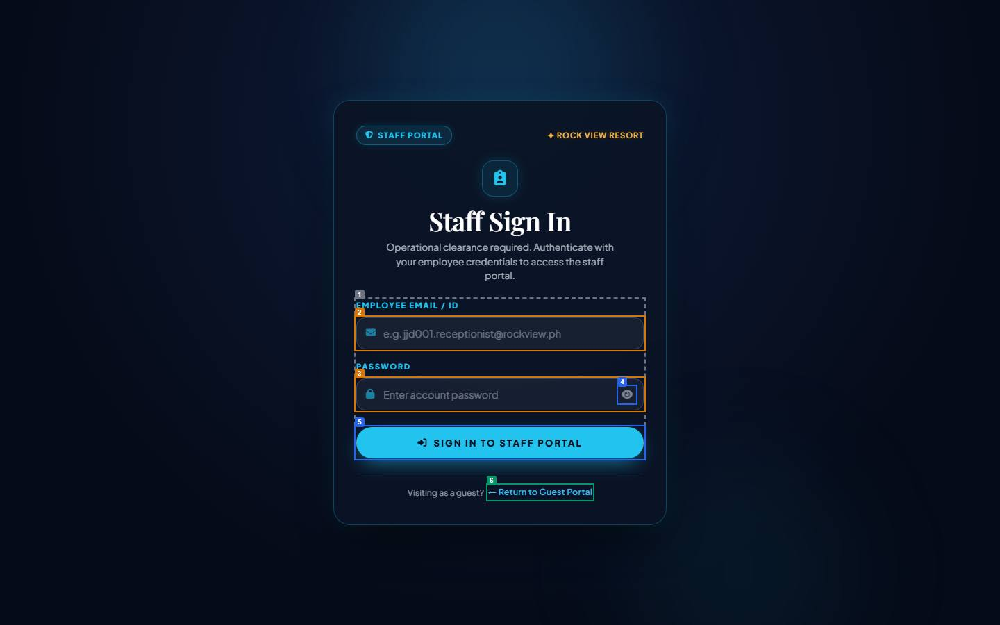

| # | Type | Label | Goes to / state |
|---|---|---|---|
| 1 | form | _(none)_ |  |
| 2 | field | EMPLOYEE EMAIL / ID |  |
| 3 | field | PASSWORD |  |
| 4 | button | Show password |  |
| 5 | button | SIGN IN TO STAFF PORTAL |  |
| 6 | link | ← Return to Guest Portal | `/` |

## 13-staff-forgot-password

**Address:** `/staff/login` · **View:** desktop 1440x900 · **Page height:** 900px · Note: the scripted click did not find its target, so this shows the page without it

| # | Type | Label | Goes to / state |
|---|---|---|---|
| 1 | form | _(none)_ |  |
| 2 | field | EMPLOYEE EMAIL / ID |  |
| 3 | field | PASSWORD |  |
| 4 | button | Show password |  |
| 5 | button | SIGN IN TO STAFF PORTAL |  |
| 6 | link | ← Return to Guest Portal | `/` |

## 14-admin-login

**Address:** `/admin` · **View:** desktop 1440x900 · **Page height:** 900px

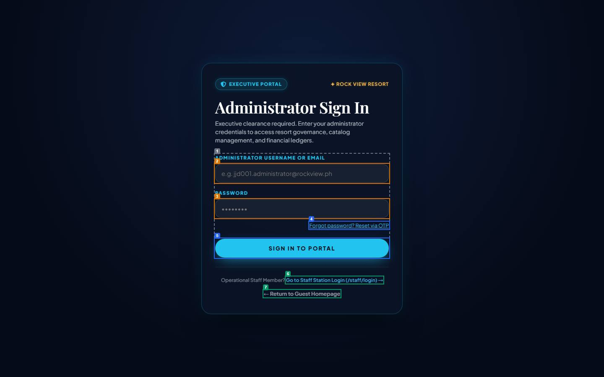

| # | Type | Label | Goes to / state |
|---|---|---|---|
| 1 | form | _(none)_ |  |
| 2 | field | e.g. jjd001.administrator@rockview.ph |  |
| 3 | field | •••••••• |  |
| 4 | button | Forgot password? Reset via OTP |  |
| 5 | button | SIGN IN TO PORTAL |  |
| 6 | link | Go to Staff Station Login (/staff/login) → | `/staff/login` |
| 7 | link | ← Return to Guest Homepage | `/` |

## 15-recovery

**Address:** `/recovery` · **View:** desktop 1440x900 · **Page height:** 901px

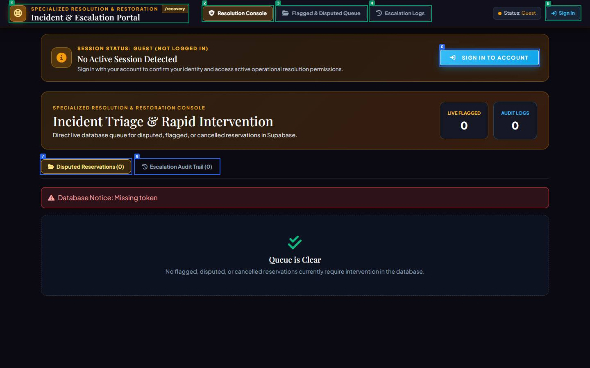

| # | Type | Label | Goes to / state |
|---|---|---|---|
| 1 | link | SPECIALIZED RESOLUTION & RESTORATION /recovery Incident & Escalation Portal | `/recovery`, stays on screen when scrolling |
| 2 | link | Resolution Console | `/recovery`, stays on screen when scrolling |
| 3 | link | Flagged & Disputed Queue | `/recovery/cases`, stays on screen when scrolling |
| 4 | link | Escalation Logs | `/recovery/audit`, stays on screen when scrolling |
| 5 | link | Sign In | `/admin/login`, stays on screen when scrolling |
| 6 | button | SIGN IN TO ACCOUNT |  |
| 7 | button | Disputed Reservations (0) |  |
| 8 | button | Escalation Audit Trail (0) |  |

## 16-mobile-home

**Address:** `/` · **View:** mobile 390x844 · **Page height:** 6454px

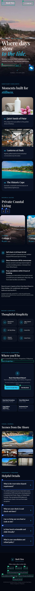

| # | Type | Label | Goes to / state |
|---|---|---|---|
| 1 | link | Rock View Beach Resort | `/`, stays on screen when scrolling |
| 2 | link | SIGN IN | `/client/login`, stays on screen when scrolling |
| 3 | link | Already have an account? Sign in → | `/client/login` |
| 4 | button | Scroll accommodations left |  |
| 5 | button | Scroll accommodations right |  |
| 6 | link | Open in Google Maps ↗ | `https://www.google.com/maps/search/?api=1&query=Rock+View+Beach+Resort,+Patar+Road,+Bolinao,+Pangasinan` |
| 7 | link | Open in Google Maps | `https://www.google.com/maps/search/?api=1&query=Rock+View+Beach+Resort,+Patar+Road,+Bolinao,+Pangasinan` |
| 8 | link | Get directions | `https://www.google.com/maps/dir/?api=1&destination=Rock+View+Beach+Resort,+Patar+Road,+Bolinao,+Pangasinan` |
| 9 | button | What is the reservation deposit requirement? + |  |
| 10 | button | What are your check-in and check-out times? + |  |
| 11 | button | Can we bring our own food or cook on site? + |  |
| 12 | button | Is Patar beach swimmable and child-friendly? + |  |
| 13 | button | What is your cancellation and refund policy? + |  |
| 14 | link | Instagram | `https://www.instagram.com/rockviewbeachresort` |
| 15 | link | Facebook | `https://www.facebook.com/rockviewbeachresort` |
| 16 | link | TikTok | `https://www.tiktok.com/@rockviewbeachresort` |
| 17 | link | 50% Downpayment Policy & Rules | `/policy` |
| 18 | link | Cancellation & Rebooking | `/policy#cancellation` |
| 19 | link | Resort House Guidelines | `/policy#house-rules` |
| 20 | link | Privacy & Terms | `/policy#privacy` |
| 21 | button | Open 24/7 Resort Concierge Chat | stays on screen when scrolling |

## 17-mobile-home-chat-open

**Address:** `/` · **View:** mobile 390x844 · **Page height:** 6454px

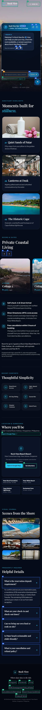

| # | Type | Label | Goes to / state |
|---|---|---|---|
| 1 | link | Rock View Beach Resort | `/`, stays on screen when scrolling |
| 2 | link | SIGN IN | `/client/login`, stays on screen when scrolling |
| 3 | link | Already have an account? Sign in → | `/client/login` |
| 4 | button | Scroll accommodations left |  |
| 5 | button | Scroll accommodations right |  |
| 6 | link | Open in Google Maps ↗ | `https://www.google.com/maps/search/?api=1&query=Rock+View+Beach+Resort,+Patar+Road,+Bolinao,+Pangasinan` |
| 7 | link | Open in Google Maps | `https://www.google.com/maps/search/?api=1&query=Rock+View+Beach+Resort,+Patar+Road,+Bolinao,+Pangasinan` |
| 8 | link | Get directions | `https://www.google.com/maps/dir/?api=1&destination=Rock+View+Beach+Resort,+Patar+Road,+Bolinao,+Pangasinan` |
| 9 | button | What is the reservation deposit requirement? + |  |
| 10 | button | What are your check-in and check-out times? + |  |
| 11 | button | Can we bring our own food or cook on site? + |  |
| 12 | button | Is Patar beach swimmable and child-friendly? + |  |
| 13 | button | What is your cancellation and refund policy? + |  |
| 14 | link | Instagram | `https://www.instagram.com/rockviewbeachresort` |
| 15 | link | Facebook | `https://www.facebook.com/rockviewbeachresort` |
| 16 | link | TikTok | `https://www.tiktok.com/@rockviewbeachresort` |
| 17 | link | 50% Downpayment Policy & Rules | `/policy` |
| 18 | link | Cancellation & Rebooking | `/policy#cancellation` |
| 19 | link | Resort House Guidelines | `/policy#house-rules` |
| 20 | link | Privacy & Terms | `/policy#privacy` |
| 21 | button | Restart chat | stays on screen when scrolling |
| 22 | button | Close chat | stays on screen when scrolling |
| 23 | button | Thumbs up - Helpful | stays on screen when scrolling |
| 24 | button | Thumbs down - Needs improvement | stays on screen when scrolling |
| 25 | form | _(none)_ | stays on screen when scrolling |
| 26 | field | Ask about rooms, rates, amenities, check-in… | stays on screen when scrolling |
| 27 | button | SEND | disabled, stays on screen when scrolling |
| 28 | button | Open 24/7 Resort Concierge Chat | stays on screen when scrolling |

## 18-mobile-guest-login

**Address:** `/client/login` · **View:** mobile 390x844 · **Page height:** 1172px

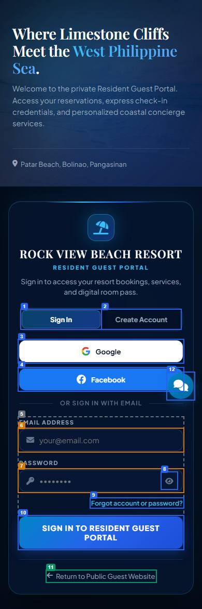

| # | Type | Label | Goes to / state |
|---|---|---|---|
| 1 | button | Sign In |  |
| 2 | button | Create Account |  |
| 3 | button | Google |  |
| 4 | button | Facebook |  |
| 5 | form | _(none)_ |  |
| 6 | field | EMAIL ADDRESS |  |
| 7 | field | PASSWORD |  |
| 8 | button | Show password |  |
| 9 | button | Forgot account or password? |  |
| 10 | button | SIGN IN TO RESIDENT GUEST PORTAL |  |
| 11 | link | Return to Public Guest Website | `/` |
| 12 | button | Open 24/7 Resort Concierge Chat | stays on screen when scrolling |

## 19-mobile-guest-create-account

**Address:** `/client/login` · **View:** mobile 390x844 · **Page height:** 1382px

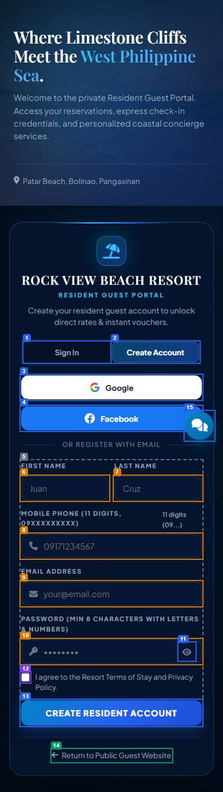

| # | Type | Label | Goes to / state |
|---|---|---|---|
| 1 | button | Sign In |  |
| 2 | button | Create Account |  |
| 3 | button | Google |  |
| 4 | button | Facebook |  |
| 5 | form | _(none)_ |  |
| 6 | field | FIRST NAME |  |
| 7 | field | LAST NAME |  |
| 8 | field | MOBILE PHONE (11 DIGITS, 09XXXXXXXXX) |  |
| 9 | field | EMAIL ADDRESS |  |
| 10 | field | PASSWORD (MIN 8 CHARACTERS WITH LETTERS & NUMBERS) |  |
| 11 | button | Show password |  |
| 12 | checkbox | I agree to the Resort Terms of Stay and Privacy Policy. |  |
| 13 | button | CREATE RESIDENT ACCOUNT |  |
| 14 | link | Return to Public Guest Website | `/` |
| 15 | button | Open 24/7 Resort Concierge Chat | stays on screen when scrolling |

## 20-mobile-policy

**Address:** `/policy` · **View:** mobile 390x844 · **Page height:** 9227px

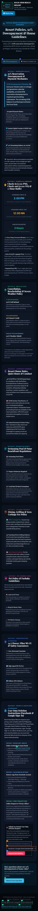

| # | Type | Label | Goes to / state |
|---|---|---|---|
| 1 | link | Back to Resort | `/`, stays on screen when scrolling |
| 2 | link | Book a Stay | `/#booking`, stays on screen when scrolling |
| 3 | button | 50% Downpayment |  |
| 4 | button | Check-in / Check-out |  |
| 5 | button | Cancellation & Weather |  |
| 6 | button | House Rules & Quiet Hours |  |
| 7 | button | Pool & Beachfront |  |
| 8 | button | Dining & Zero Corkage |  |
| 9 | button | Pet Policy |  |
| 10 | button | Power, Wi-Fi & Safety |  |
| 11 | button | User Data Deletion |  |
| 12 | link | Resident Guest Portal | `/client/login` |
| 13 | form | _(none)_ |  |
| 14 | field | Enter your Facebook / Google account email address... |  |
| 15 | dropdown | Deletion scope |  |
| 16 | button | Request Data Deletion |  |
| 17 | link | Reserve Your Stay Now | `/#booking` |
| 18 | link | Home | `/` |
| 19 | link | Rooms & Cottages | `/rooms` |
| 20 | link | Guest Dashboard | `/client/bookings` |
| 21 | link | Policies & 50% Deposit | `/policy` |
| 22 | link | User Data Deletion | `/data-deletion` |
| 23 | button | Open 24/7 Resort Concierge Chat | stays on screen when scrolling |
