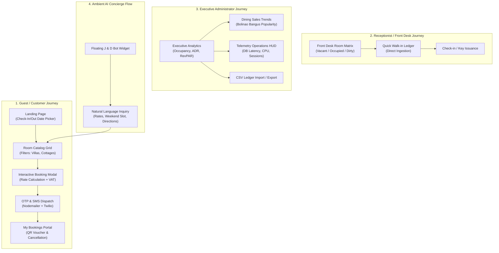

# J & D Reserve: Low-Fidelity Prototype & Wireframe Architecture Specification

> **Capstone Project Title:** *J & D Reserve: A Web-Based Reservation and Booking Management System for J & D Beach House, Brgy. Patar, Bolinao, Pangasinan*  
> **Document Type:** Low-Fidelity (Lo-Fi) UI/UX Prototype Specification & Architectural Blueprint  
> **Target Audience:** Capstone Defense Panel, System Architects, UI/UX Evaluators  

---

## 1. Executive Summary & Design Rationale

The **Low-Fidelity (Lo-Fi) Prototype** establishes the structural layout, user journey pathways, information hierarchy, and interface affordances for the J & D Reserve platform before high-fidelity visual styling.

### Core Architectural Principles
1. **Frictionless Guest Booking**: 3-step progressive disclosure flow (Availability Search → Unit Selection → Instant OTP/SMS Confirmation).
2. **Operational Transparency for Staff**: Consolidated front desk status matrix uniting physical walk-ins and digital bookings.
3. **Data-Driven Executive Oversight**: Centralized business intelligence dashboard presenting real-time yield KPIs (Occupancy %, ADR, RevPAR, Dining Trends).
4. **Resilient Monochromatic Blueprint Aesthetic**: Eliminates subjective aesthetic distractions (colors, high-res photography) to focus panel review on usability, logic, and functional completeness.

---

## 2. Low-Fidelity System Wireframe Board

Below is the architectural wireframe board mapping the cross-screen relationships:

---

## 3. End-to-End User Journey Flows

---

## 4. Screen-by-Screen Blueprint Specifications

### Screen 1: Guest Landing & Real-Time Availability Engine
- **Header Navigation**:
  - Logo Wireframe Box (`[ J&D ]`)
  - Navigation links: `Accommodations`, `Resort Amenities`, `Local Tours`, `Getting to Bolinao`
  - Auth controls: `My Bookings (Vouchers)` and `Sign In / Register`
- **Hero & Search Bar Component**:
  - Check-in Date Picker (`YYYY-MM-DD`)
  - Check-out Date Picker (`YYYY-MM-DD`)
  - Guest Count Dropdown (`Adults`, `Children`)
  - Action CTA: `[ SEARCH ROOMS → ]` (Bound to Supabase RPC `available_rooms`)
- **Accommodations Card Matrix (3-Column Responsive Grid)**:
  - Wireframe Image Placeholder with diagonal cross (`[ 16:9 Image Placeholder ]`)
  - Room Title, Rate per Night (`₱ / night`), Capacity Badge (`👥 Sleeps N`)
  - Feature badges: `AC & Hot Shower`, `High-Speed Wi-Fi`, `Direct Beach Access`
  - Dynamic Stock Indicator: `● N Units Available`
  - Action Button: `[ RESERVE NOW ]`

---

### Screen 2: Multi-Step Reservation & Checkout Modal
- **Progress Indicator**: Step 2 of 3 (Guest Checkout & Validation)
- **Selected Unit Summary Ribbon**:
  - Room Name, Selected Check-in/Out Dates, Duration (`3 Nights`), Guest Count
- **Input Fields**:
  - First Name, Last Name
  - Mobile Phone (Required for Twilio SMS confirmation ping)
  - Account Email (Required for Nodemailer 6-digit OTP delivery)
  - Special Inquiries / Requests (Textarea)
- **Automated Financial Calculation Card**:
  $$\text{Base Room Total} = \text{Rate} \times \text{Nights}$$
  $$\text{Service Fee} = \text{Eco-Tourism Levy (Fixed)}$$
  $$\text{VAT (12\%)} = (\text{Base Room Total} + \text{Service Fee}) \times 0.12$$
  $$\text{Grand Total (PHP)} = \text{Sum of Line Items}$$
- **Submission Actions**:
  - `[ ← Back to Rooms ]`
  - `[ Confirm & Dispatch SMS Ping ✦ ]`

---

### Screen 3: "My Bookings" Self-Service Guest Dashboard
- **Active Reservation Cards**:
  - Unique Booking Reference ID (`#JD-2026-9042`)
  - Real-Time Status Badge (`CONFIRMED`, `CHECKED_IN`, `CHECKED_OUT`, `CANCELLED`)
  - Stay Period, Room Type, Total PHP Paid
- **QR Code Fast Pass**:
  - Placeholder box for on-ground front desk scanner check-in
- **Self-Service Controls**:
  - `[ Download PDF Voucher ]`
  - `[ Request Add-on Dining Platter ]`
  - `[ Cancel Reservation (Free) ]` (Triggers instant SMS cancellation alert)

---

### Screen 4: Front Desk Matrix & Quick Walk-In Ledger
- **Room Status Grid (Matrix Table)**:
  - Columns: Room Name, Pax Capacity, Base Rate, Day 1 Status, Day 2 Status, Day 3 Status, Actions
  - State Indicators:
    - `AVAILABLE` (Emerald wire badge)
    - `OCCUPIED` (Blue wire badge)
    - `CLEANING / TURNAROUND` (Amber wire badge)
- **Walk-in Ledger Quick Intake Drawer**:
  - Direct walk-in form bypasses online payment gateway
  - Fields: Guest Name, Contact Number, Assigned Room Dropdown, Immediate Check-in Toggle

---

### Screen 5: Executive Business Intelligence & Analytics
- **Top 4 KPI Metrics**:
  - **Monthly Occupancy Rate**: Real-time percentage calculated from room nights
  - **Average Daily Rate (ADR)**: $\frac{\text{Room Revenue}}{\text{Total Room Nights Sold}}$
  - **RevPAR (Revenue Per Available Room)**: $\text{ADR} \times \text{Occupancy Rate}$
  - **AI Automation Rate**: % of guest inquiries resolved without human staff intervention
- **7-Day Revenue & Booking Evolution**:
  - Monochromatic vertical bar chart with day labels (`Mon` through `Sun`)
  - Highlighted weekend demand surge peaks
- **Dining & Kitchen Popularity Trend Table**:
  - Top earner badge: *Grilled Bolinao Bangus Feast*
  - Popularity meter progress bars derived dynamically from `resort_orders`

---

### Screen 6: Persistent Floating AI Concierge Drawer (J & D Bot)
- **Header**: Active status dot (`Online`), bot title, collapse toggle
- **Message Area**:
  - System greeting with Tagalog hospitality touch (*"Mabuhay! I am J & D Bot..."*)
  - Dynamic prompt chip buttons (`[ Room Rates ]`, `[ Weekend Availability ]`, `[ Directions from Manila ]`)
  - Conversational bubbles (Guest vs. Bot)
- **Composer**: Text input with send button and character limiter (500 chars)

---

## 5. Interactive Prototype Access

An interactive, clickable version of this Low-Fidelity Prototype has been generated in the project workspace:

- **Interactive Prototype File:** [lofi_prototype.html](file:///C:/Users/Sheep/.gemini/antigravity/brain/26952f48-8b2b-4676-9047-14d6a417755f/lofi_prototype.html)
- **Features in Interactive Version**:
  - Clickable tab switcher across all 5 key screens.
  - Interactive AI Concierge Chat Drawer toggle.
  - Toggleable Architectural Annotations.
  - Responsive layout for desktop and tablet evaluation.
